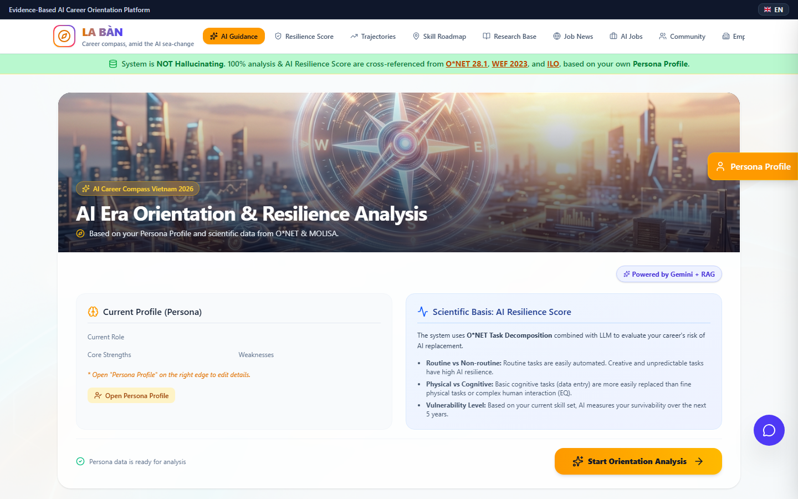

# La Bàn — Agentic Career Compass for Vietnam's AI Transition

La Bàn (The Compass) helps Vietnamese workers and students see how AI changes
their jobs and what to do about it — grounded in verifiable evidence instead
of generic advice.



## Who has this problem?

Vietnamese office workers, industrial workers and students facing the AI
transition (accountants, garment workers, teachers, developers, nurses,
farmers...). Career guidance today is either generic listicles or expensive
human consulting. A junior accountant in Hanoi asking "will AI take my job
and what should I learn?" gets opinions, not evidence.

## The bottleneck

Trust. A single LLM prompt produces fluent career advice that cites research
papers which may not exist. In our measured baseline over 16 personas, 3
hallucinated citations appeared in the representative run alone — and in an
exploratory run the baseline failed on personas with malformed JSON. For
life-altering career decisions, unverifiable evidence is disqualifying.

## What existed before vs. what this competition added

**Pre-existing (commit 4c5ac25, built earlier for #BuildwithGoogleAI):** the
React platform, curated data (research library, Vietnam occupation database,
golden personas), the single-shot Gemini endpoints, community/employer/news
modules, and the frozen baseline prompt.

**Added during this hackathon (all commits after 4c5ac25):**
- `src/agents/` — the 4-agent pipeline: Profiler → Evidence Gatherer
  (Gemini function-calling over 3 deterministic tools) → Analyst → Verifier
  with a repair loop (max 2 retries, plus parse-error recovery)
- Decision-coherence checks — the verifier rejects top recommendations below
  the user's current-occupation resilience floor and any 'declining' demand
  signal, so advice never points down a ladder its own evidence says is
  collapsing
- Registry-grounded, budget-aware learning resources — suggestion milestones
  must include a free resource from a curated, HTTP-verified registry and fit
  the user's monthly budget (costTier + estimatedCostVND on every milestone)
- Worker segmentation and equity breakdown of every eval metric
- Counselor-review checkpoint (human in the loop) demonstrated in-sandbox;
  EN-primary output localization with dual VND/USD cost display at a fixed
  documented rate computed in code, never by the model
- `eval/` — 16 personas (incl. 1 challenging case) across 5 worker segments,
  3-rep stability protocol, automatic scoring, HTTP-driven runner, published
  results
- Agent transparency panel in the UI
- Removed Firebase (Google auth + Firestore pointed at the author's earlier
  project with public-write rules) and replaced persistence with localStorage
  so the submission is fully self-contained
- This README, the changelog, reproduction guide, evaluation report,
  trajectories, and video script

## Agent architecture

```
User intake
   → Profiler (normalize, extract occupation keywords, risk flags)
   → Evidence Gatherer (max 6 tool calls: lookupOccupation, searchResearch,
                        searchLearningResources, getOccupationNews —
                        only real curated sources and registry URLs enter)
   → Analyst (synthesize suggestions; may cite ONLY the gathered pack;
              cost tiers + budget-fit milestones, EN/VI output)
   → Verifier (schema + guardrail + citation-grounding + resource-URL
               grounding + decision-coherence checks + LLM judge;
               failures fed back → up to 2 repairs; parse errors retried)
   → Counselor review checkpoint (human approval, logged in trajectory)
   → Result + full trajectory
```

Every design choice targets a measured failure mode — see
[docs/IMPROVEMENT_CHANGELOG.md](docs/IMPROVEMENT_CHANGELOG.md).

## Social-impact safeguards

- **Decision coherence:** the verifier rejects top recommendations whose
  resilience falls below the user's current-occupation floor (55 when the
  occupation is unmatched) and any Vietnam demand signal that reads
  'declining' — verified advice must not point users into shrinking work.
- **Grounded, budget-aware resources:** every suggestion's free-resource URL
  exact-matches a curated, HTTP-verified registry; milestones carry
  `costTier` + `estimatedCostVND`; at least one milestone per suggestion must
  fit the user's monthly budget.
- **Equity:** eval results are broken down by worker segment (knowledge,
  wage, rural/agricultural, student, craft/trade) so improvements are checked
  for the most exposed groups, not just on average.
- **Human in the loop:** a counselor-review checkpoint is demonstrated
  in-sandbox; all output is advisory. Production deployments must deliver
  through a qualified counselor.
- **Currency:** USD figures use a fixed documented rate of 1 USD = 26,000 VND
  (approximate interbank rate, set 2026-10-13), computed in code — never by
  the model.

## Measured improvement (3 reps x 16 personas, mean ± sd)

| Metric | Baseline | Final agent |
|---|---|---|
| Evidence grounding rate (primary) | 89.5% ±1.5% | **99.0% ±1.5%** |
| Risk coherence rate | 100.0%* | 95.8% ±5.9% (vs **87.5%** tools-only) |
| Actionable-path rate | 0.0% ±0.0% | **93.8%** ±0.0% |
| Schema-valid runs | 100% | 100% |
| Personalization (judge 0-100) | 86 ±2 | 80 ±3 |

\* The baseline's coherence floor is weaker (no occupation lookup → default
55); the operative comparison is the ablation: tools alone dropped coherence
to 87.5% ±5.1 — the verifier repaired most of those incoherent directions.

Full tables, segment breakdown and honest failure notes:
[docs/EVALUATION.md](docs/EVALUATION.md). Representative agent
runs: [docs/TRAJECTORIES.md](docs/TRAJECTORIES.md).

## Quick start

```bash
npm install
cp .env.example .env   # set GEMINI_API_KEY
npm run dev            # http://localhost:3000
```

Reproduce the evaluation (server must be running, in a second terminal):
```bash
npm run eval        # 3 reps x 16 personas x 3 configs (~60-75 min, ~$0.55)
```

Tests: `npm test` — TypeScript check: `npm run lint`.

## Hot take

Retrieval alone did not stop citation fabrication: with tools but no
verifier, hallucinated citations persisted in every configuration without a
gate (89.5% ±1.5% baseline grounding, 3 fabricated citations in the
representative run). The verification loop that could send work back to the
analyst eliminated them (99.0% ±1.5%, and the single residual miss shipped
honestly with a visible `repair` verdict rather than silently). When
reliability matters, build the agent that can reject and retry its own
output — not just the one that reads more context. And verified authenticity
is not the same as sound direction: tools alone actively INTRODUCED
incoherent recommendations (87.5% coherence) whose citations were all real —
the verifier now rejects recommendations whose own evidence signals decline,
and grounding has extended from citations to every learning-resource URL
(0% → 93.8% actionable paths).

## License & attribution

See LICENSE. Curated data sources are public research summaries (WEF, ILO,
McKinsey, TopCV, ...). Synthetic evaluation personas contain no personal data.
